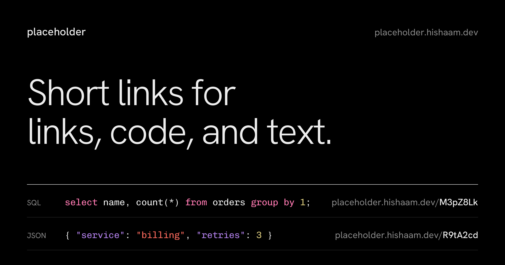
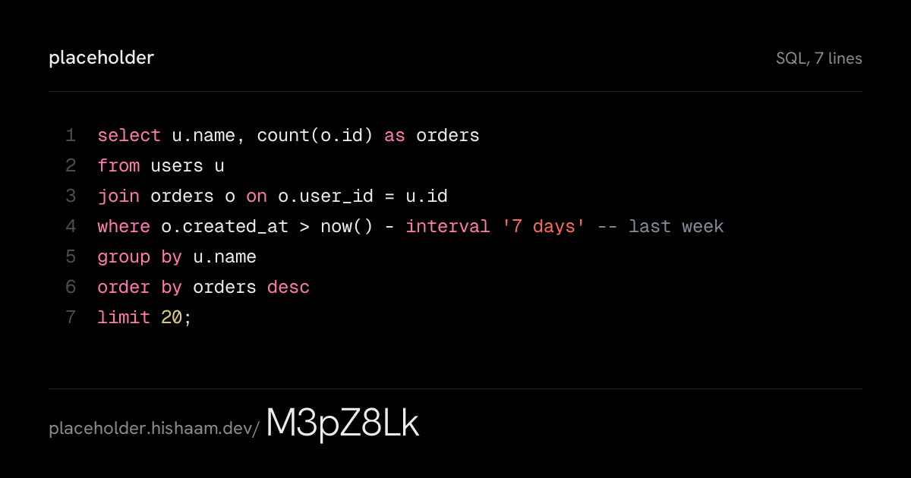

<!-- markdownlint-disable MD033 -->

<p align="center">
  
</p>

## placeholder

[](https://github.com/mdhishaamakhtar/placeholder/actions/workflows/ci.yml)
[](./LICENSE)

placeholder turns a paste into a short link. Paste a URL and the link redirects to it. Paste code and the link opens a clean page with it, language detected, colored like your editor, and one click away from tidy. Paste notes or logs and they're set in readable type. Nothing you paste is ever run or rendered.

It's written in Kotlin from the database to the browser, and built as a system design showcase: stateless servers behind a load balancer, three cache layers, a click-analytics pipeline that counts every visit exactly once, and failure experiments that show what happens when each dependency breaks. **[The design document](./docs/system-design.md)** walks through all of it, with [decision records](./docs/adr/README.md) for each trade-off.

## What It Does

- Shortens URLs, with instant `302` redirects served from an in-memory cache
- Shares code with language detection, syntax highlighting, and Prettify for JSON, SQL, HTML, and XML
- Shares text and Markdown as a quiet, readable page
- Accounts with email and password: your links on every device, edit them in place, or set them to expire. Making links needs an account; opening them never does
- Visits for every link you make: a count in your list, and a page per link with unique visitors and the last 30 days, day by day. Counted off the request path, so redirects never wait on them
- Link previews that show the content: share a SQL snippet in Slack and the card shows the query, colored
- Dark and light themes, rendered on the server so there's never a flash of the wrong one

<p align="center">
  
</p>

## Tech Stack

[](https://kotlinlang.org/)
[](https://ktor.io/)
[](https://kobweb.varabyte.com/)
[](https://github.com/JetBrains/compose-multiplatform#compose-html)
[](https://openjdk.org/)
[](https://gradle.org/)
[](https://www.postgresql.org/)
[](https://redis.io/)
[](https://github.com/JetBrains/Exposed)
[](https://docs.docker.com/compose/)
[](https://kafka.apache.org/)
[](https://prometheus.io/)
[](https://grafana.com/)
[](https://datasketches.apache.org/)

## How It Fits Together

```text
            browser                                     link-preview crawlers
               │                                                 │
               ▼                                                 ▼
        ┌─────────────┐   round-robin   ┌──────────────────────────────────────────┐
        │    nginx    │ ──────────────▶ │  Ktor app × N   (stateless, identical)    │
        └─────────────┘                 │  serves the Kobweb site, the JSON API,    │
                                        │  redirects, and the preview cards         │
                                        │  ┌────────────────┐  ┌─────────────────┐  │
                                        │  │ in-memory cache│  │ Kafka producer +│  │
                                        │  │ + coalescing   │  │ click consumer  │  │
                                        │  └────────────────┘  └─────────────────┘  │
                                        └──────┬─────────────────┬──────────┬───────┘
                                               │                 │          │
                            cache, rate limits,│   snips, users, │          │ click events,
                            cross-app evictions│   visit rollups │          │ keyed by slug
                                               ▼                 ▼          ▼
                                         ┌──────────┐     ┌──────────┐ ┌──────────────┐
                                         │  Redis   │     │ Postgres │ │    Kafka     │
                                         │ (cache)  │     │          │ │ (12 parts.)  │
                                         └──────────┘     └──────────┘ └──────────────┘
```

- **One language, one deployable.** The browser app is Kotlin compiled to JavaScript with Kobweb; the server is Ktor. They share one module of request and response types and validation rules, so the page never promises something the API rejects.
- **Three cache layers for reads.** Each app keeps hot snips in memory, then Redis, then Postgres. Links made before accounts existed can never change, so they're cached forever, by browsers and CDNs too. Links with an owner can be edited, so browsers revalidate them by version (a cheap `304`), and an edit tells every app instance to drop its copy through Redis pub/sub.
- **Redis is optional.** If it's slow or down, the app keeps serving from Postgres, and rate limits fail open rather than taking the site down.
- **A viral link reaches the database once per server, not once per request.** Concurrent misses for the same link wait for one lookup instead of each making their own.
- **Visits are counted exactly once, off the request path.** A redirect hands the visit to Kafka's producer, which never blocks it. Visits are keyed by link, and a consumer group (one consumer per server) writes them to Postgres in batches, committing offsets only after the database commits. Delivery is at-least-once, and every visit carries an id that Postgres uses to skip repeats, so each is counted once. Unique visitors are HyperLogLog sketches, merged across days, and no IP address is stored. If Postgres is down, visits wait in Kafka; if Kafka is down, each server holds them for up to two minutes.
- **Accounts are deliberately boring.** Passwords are hashed with Argon2id at OWASP settings. Sessions are random tokens, stored only as a SHA-256 hash, in an HttpOnly, SameSite=Lax cookie, and signing out revokes them on the server. Writes that carry the cookie must come from the site's own origin. Sign-ins are rate-limited per IP and per email, and a wrong email gets exactly the same answer as a wrong password.
- **Expired links answer `410 Gone`.** An hourly job, run by one instance at a time via a Redis lock, removes them along with expired sessions.
- **The server writes each page's head.** Kobweb builds one `index.html`; Ktor parses it once with jsoup and, per request, adds that page's title, description, Open Graph and Twitter tags, and the visitor's theme. Crawlers see the right preview without running any script, and pasted content is escaped by construction.

## Documentation

| | |
|---|---|
| [System design](./docs/system-design.md) | Requirements, estimates, the read and write paths, click analytics, failure modes, and what changes at 10x and 100x |
| [Benchmarks](./docs/benchmarks.md) | Load tests, a cold viral link, failure experiments, with dashboard screenshots from each run |
| [Decision records](./docs/adr/README.md) | One page per trade-off: what was chosen, what was turned down, and when to revisit |
| [Design system](./docs/design-system.md) | The UI's type, spacing, motion and theme tokens |

## Running It Yourself

### What you need

- **Java 25.** The build always runs on Java 25, found automatically, even if your terminal's default `java` is a different version.
- **Docker**, for Postgres and Redis, and for the tests.
- **[oha](https://github.com/hatoo/oha)**, only if you want to run the benchmarks (`brew install oha`).

You don't need Gradle, Node, or anything else installed: `./gradlew` downloads the right Gradle, and the build fetches its own Node to compile the site.

### Run it

```bash
docker compose up -d
```

```bash
./gradlew :server:run
```

The first command starts Postgres, Redis and Kafka in the background. The second builds the site and the server and starts it at [http://localhost:8080](http://localhost:8080); create an account there to start making links. Stop the server with `Ctrl+C`.

After changing anything in `web/`, rebuild the site and reload the page (the server picks it up without restarting):

```bash
./gradlew :web:assembleSite
```

### Run the tests

```bash
./gradlew :shared:jvmTest :shared:jsTest :server:test
```

### Format and lint

One formatter and linter for the whole repository: [ktlint](https://pinterest.github.io/ktlint/) with its default rules, run through [Spotless](https://github.com/diffplug/spotless), which also keeps whitespace tidy in every other text file. Fix everything in one go:

```bash
./gradlew spotlessApply
```

CI runs `./gradlew spotlessCheck` first and fails on anything unformatted.

### Run the whole stack in Docker

Three app servers behind nginx, with Postgres, Redis, Kafka, Prometheus and Grafana, the way it would run in production. Build first, then start:

```bash
./gradlew :server:installDist :web:assembleSite
```

```bash
docker compose --profile stack up -d --build
```

It's at [http://localhost:8080](http://localhost:8080), so stop `./gradlew :server:run` first if it's running. The Grafana dashboard is at [http://localhost:3000](http://localhost:3000) and Prometheus at [http://localhost:9090](http://localhost:9090).

### Redraw the preview images

The two images in this README are drawn by the same code the server uses for link previews:

```bash
./gradlew :server:renderPreviews
```

### Stop everything

Stop the containers (your data is kept):

```bash
docker compose --profile stack down
```

Stop and also delete the database and cache data, for a clean slate:

```bash
docker compose --profile stack down -v
```

Stop Gradle's background build processes:

```bash
./gradlew --stop
```

**About those background processes:** the first `./gradlew` command starts a Gradle "daemon", a Java process that stays running after the build so the next build starts in seconds instead of warming up from scratch (Kotlin starts its own compiler daemon for the same reason). They shut themselves down after a few idle hours. Stop them by hand to free memory, or before benchmarking so they don't compete for CPU.

## Configuration

Settings live in [`server/src/main/resources/application.yaml`](./server/src/main/resources/application.yaml). Each one can be overridden with an environment variable, and every default works on a laptop.

| Variable | Default | What it does |
|---|---|---|
| `PORT` | `8080` | Port the server listens on |
| `PUBLIC_BASE_URL` | `http://localhost:8080` | The site's own address: used in short links, previews, and the cross-site check. Use `https://` in production so session cookies are marked Secure. |
| `DATABASE_URL` | `jdbc:postgresql://localhost:5432/placeholder` | Postgres JDBC URL |
| `DATABASE_USER` / `DATABASE_PASSWORD` | `placeholder` | Postgres credentials |
| `DATABASE_POOL_SIZE` | `16` | Connections per app instance |
| `REDIS_URL` | `redis://localhost:6379` | Leave empty to run without Redis |
| `WEB_ROOT` | empty | Folder with the built site (`web/build/site`). Empty runs the API alone. |
| `TRUST_PROXY_HEADERS` | `false` | Trust `X-Forwarded-*`. Only behind a proxy you control. |
| `CREATES_PER_MINUTE` | `30` | New links per client per minute |
| `AUTH_PER_MINUTE` | `10` | Sign-ups and sign-ins per client per minute |
| `KAFKA_BOOTSTRAP_SERVERS` | `localhost:9092` | Kafka brokers, comma-separated. Clicks travel through the `clicks` topic, which the app creates. |
| `KAFKA_REPLICATION_FACTOR` | `1` | Copies of each partition when the topic is created: 1 for one local broker, 3 in production. |
| `VISITOR_KEY` | `local-development-only` | Secret for anonymous visitor ids. Set a long random value in production, the same on every instance. |

## Tests

Server tests run against real Postgres and Redis through Testcontainers, so Docker must be running. They cover redirects, storage and reads, validation and size limits, Prettify, rate limits, running without Redis, 404 and 410 pages (including over gzip), theme rendering, meta tags that hostile pastes can't break out of, accounts: sign-up and sign-in, session revocation, the cross-site write check, ownership and edit permissions, expiry, and an edit on one app instance reaching another instance's cache; and click analytics against a real Kafka: visits counted once end to end, bots skipped, redirects still working with Kafka unreachable, a redelivered batch not counted twice, a batch a dead consumer never committed counted by another, unique-visitor estimates within 3%, and stats visible only to the owner. The shared rules (link detection, slugs, sign-in redirects) are tested on both the JVM and in a headless browser.

CI runs all of it, plus a production build of the site, on every push and pull request.

## Benchmarks

On one laptop running the whole stack, three servers serve **19,500 redirects a second** (p99 47 ms) while counting every one of them through Kafka. A viral link nobody had cached took 5,000 simultaneous requests and reached Postgres **3 times**. With Redis, Kafka or Postgres cut off under load, **no request failed**, and every visit was counted exactly once; killing a server outright lost 10 visits of 60,000.

**[The benchmarks document](./docs/benchmarks.md)** has every scenario, dashboard screenshots from each run, the bug the failure experiments caught, and how to run them yourself.

## Project Layout

```text
shared/              Kotlin Multiplatform, used by both server and browser
  Models, Rules        request and response types, limits, link and slug rules
  Paths, Languages     every page address and language name, defined once

server/              Ktor
  config/              typed view of application.yaml
  http/                routes, plugins, error handling, sessions, the page head (AppShell)
  account/             users, sessions, Argon2id password hashing
  snip/                snips: service, repository, read-through cache, slugs
  analytics/           Kafka producer and consumer for clicks, daily rollups with visitor sketches
  prettify/            JSON, SQL, HTML, and XML formatters
  og/                  link-preview cards drawn with Java2D
  infra/               database, Redis, Kafka, cross-instance eviction, rate limits, cleanup
  resources/           application.yaml, Flyway migrations, fonts for preview cards

web/                 Kobweb, compiled from Kotlin to JavaScript
  pages/               one file per route: landing, sign-in, editor, your links, a link
  editor/              the editor's state holder and its parts
  components/          shared UI: frame, menus, rows, empty and error states
  resources/public/    styles.css (the design system), fonts, favicon, robots.txt

docker/              Dockerfile, nginx, Prometheus, Grafana and Toxiproxy config for the multi-instance stack
bench/               load tests (run.sh) and failure experiments (chaos.sh)
docs/                the design document and decision records
```

## Contributor

- Md Hishaam Akhtar

<p align="center">
  Built for the "here's the SQL" moment.
</p>
