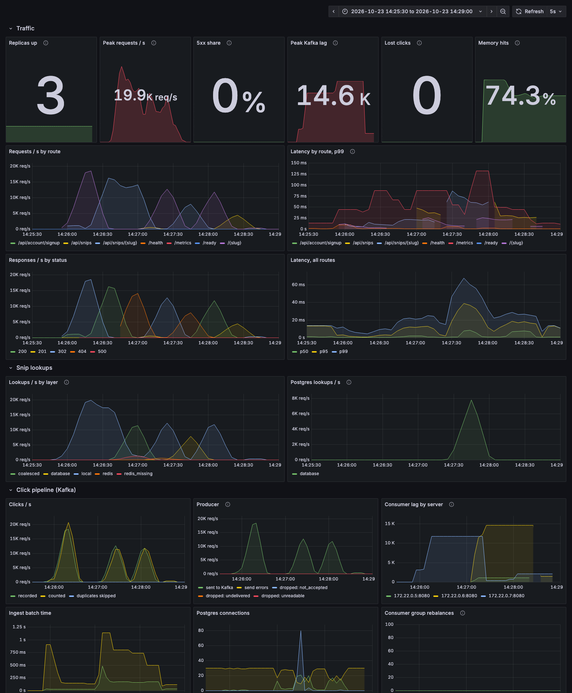

# Benchmarks and failure experiments

Two scripts measure placeholder, and the Grafana dashboard that ships with the stack shows each run as it happens:

- [`bench/run.sh`](../bench/run.sh): **load.** How much traffic the stack serves, and how fast.
- [`bench/chaos.sh`](../bench/chaos.sh): **failure.** One dependency broken at a time, under steady traffic, and whether every visit is still counted exactly once.

Everything ran on one Apple M1 Pro laptop: three app servers behind nginx, Postgres, Redis, Kafka, Prometheus, Grafana, and the load generator itself, all competing for the same CPU. Treat the numbers as a floor for that machine, not a capacity claim. Laptop runs vary by up to a third depending on what else is running.

- [Load](#load)
- [A viral link nobody has cached](#a-viral-link-nobody-has-cached)
- [Click pipeline under load: Redis Stream vs Kafka](#click-pipeline-under-load-redis-stream-vs-kafka)
- [Failure experiments](#failure-experiments)
- [Run them yourself](#run-them-yourself)

## Load

20 seconds per scenario, 200 concurrent connections (50 for creates). Every request was answered correctly in every scenario.

| Scenario | Requests/s | p50 | p95 | p99 |
|---|---:|---:|---:|---:|
| `GET /{slug}`: open a short link (302), one link | 19,539 | 7.7 ms | 26.9 ms | 46.7 ms |
| `GET /{slug}`: 10,000 links, Zipf-skewed traffic | 12,417 | 10.9 ms | 48.3 ms | 81.9 ms |
| `GET /api/snips/{slug}`: an owned link, as JSON | 16,901 | 9.0 ms | 30.7 ms | 53.0 ms |
| `GET /api/snips/{missing}`: the same dead link (404) | 15,320 | 10.6 ms | 30.7 ms | 51.9 ms |
| `GET /api/snips/{random}`: a scan, a new dead slug every time | 7,638 | 20.8 ms | 65.6 ms | 98.4 ms |
| `GET /{slug}`: a code page, gzipped | 11,664 | 11.5 ms | 51.4 ms | 86.4 ms |
| `POST /api/snips`: create a link | 4,358 | 10.1 ms | 22.5 ms | 32.4 ms |



What to look at:

- **Every redirect is also a click.** At 19,500 redirects a second, about 19,500 clicks a second go through Kafka into Postgres on the same laptop ("Clicks / s", bottom left). That's why redirects are slower here than the 24,000 a second this stack served before visits were counted.
- **Skewed traffic costs more than one hot link.** With 10,000 links visited by a Zipf distribution, the tail misses the servers' memory and goes to Redis ("Lookups / s by layer"), and each click batch updates rollups for hundreds of different links instead of one.
- **A scan reaches Postgres on every request.** Each random slug is new, so the short "doesn't exist" cache never helps: that's the 8,000 lookups a second on "Postgres lookups / s". It's still a primary-key lookup on an index in memory. [0007](adr/0007-no-bloom-filter.md) explains why there's no Bloom filter in front of it yet.

## A viral link nobody has cached

A link is edited, which evicts it from every server's memory and from Redis, and then 500 connections request it at the same moment: 5,000 requests in 0.4 seconds.

| | |
|---|---:|
| Requests | 5,000, all `302` |
| p99 | 120 ms |
| **Postgres lookups** | **3** (one per server) |

Without coalescing, each of the 500 concurrent first requests would have looked the link up in Postgres. With Caffeine's async cache, the first request on each server starts the lookup and the rest await it ([0006](adr/0006-request-coalescing.md)).

## Click pipeline under load: Redis Stream vs Kafka

The click pipeline first ran on a Redis Stream with a hand-written producer and consumer, then on Kafka ([0003](adr/0003-kafka-for-clicks.md)). The same load benchmark, before and after:

| | Redis Stream | Kafka |
|---|---:|---:|
| Clicks recorded | 810,994 | 895,649 |
| **Clicks dropped** | **185,048** | **0** |
| Counted twice | 0 | 0 |
| Peak backlog | 325,000 | 31,000 |
| Peak ingest into Postgres | ~14,000/s | ~15,600/s |

The drops weren't Redis's fault: the hand-written producer always waited out its batching timer, which capped each server at about 4,500 clicks a second. Kafka's producer only lingers when a batch isn't full.

## Failure experiments

Each experiment sends 2,000 redirects a second to one link for 30 seconds (60,000 in all). 10 seconds in, one thing breaks for 10 seconds: Toxiproxy cuts or slows the app's connection to a dependency, or one app server is killed outright (`docker kill`, no graceful shutdown). Afterwards, the script waits for the click pipeline to catch up and compares the link's visit count with the redirects actually served.

| Fault | Redirects served | Errors | p50 | p99 | Visits counted |
|---|---:|---:|---:|---:|---|
| Nothing broken | 60,000 | 0 | 0.9 ms | 28.1 ms | all 60,000 |
| Redis unreachable | 60,000 | 0 | 0.8 ms | 4.6 ms | all 60,000 |
| Kafka unreachable | 60,000 | 0 | 0.8 ms | 8.0 ms | all 60,000 |
| Postgres unreachable | 60,000 | 0 | 0.8 ms | 4.7 ms | all 60,000 |
| Postgres +250 ms per packet | 60,000 | 0 | 0.8 ms | 4.0 ms | all 60,000 |
| One of 3 app servers killed | 60,000 | 0 | 0.8 ms | 6.2 ms | 59,990 (10 lost) |


What the numbers say:

- **No fault reached a user.** Every redirect succeeded through every failure, including Postgres being unreachable: the link was in every server's memory, so redirects never needed it.
- **Redis down costs nothing visible.** Redis is a cache; the servers' own memory absorbs the hot set and Postgres answers the rest.
- **Kafka down: every visit is still counted.** Each server's producer held the clicks in memory and sent them when Kafka came back. That's not the default behaviour; see the trap below.
- **Postgres down: counts catch up.** The consumers can't commit, so they rewind and retry, while Kafka holds the clicks. On the dashboard, "Consumer lag by server" climbs during the outage and drains once Postgres is back.
- **A killed server loses only its last instant.** The clicks sitting in its producer's 20 ms batch were lost: 10 of 60,000. Its Kafka partitions moved to the other two servers after the 10-second session timeout (the lag spike near the end of the dashboard), and they picked up from the last committed offset, so nothing already in Kafka was lost or counted twice. The one-second dip in "Replicas up" is the kill.

### A trap the experiments caught

The first Kafka run lost **20,593 of 60,000 visits** when Kafka was unreachable: everything sent during the outage, with zero retries. Kafka 4's client, when no broker answers, by default discards what it knows about the cluster and bootstraps again. A producer configured never to block (as this one is, so a redirect never waits) can't add to its buffer once it has forgotten the topic's partitions, so every send fails at once. Setting `metadata.recovery.strategy=none` keeps the metadata, and the producer buffers through the outage as intended. No unit test would have found this; the experiment did on its first run.

## Run them yourself

You need Docker and [oha](https://github.com/hatoo/oha) (`brew install oha`). Stop Gradle's background processes first, so they don't compete for CPU:

```bash
./gradlew :server:installDist :web:assembleSite && ./gradlew --stop
```

**Load.** Start the stack with the per-client create limit raised (otherwise the create test measures the rate limiter), then run the script. It needs Prometheus, which is part of the stack, to count Postgres lookups for the viral-link test.

```bash
CREATES_PER_MINUTE=1000000 docker compose --profile stack up -d --build
```

```bash
bench/run.sh
```

**Failures.** Start the stack with Toxiproxy between the app and its dependencies, then run the experiments (about five minutes):

```bash
docker compose -f compose.yaml -f docker/compose.chaos.yaml --profile stack up -d --build
```

```bash
bench/chaos.sh
```

Results are written to `bench/results/` as raw oha JSON plus a `summary.md`. Watch either run live at [http://localhost:3000](http://localhost:3000).
