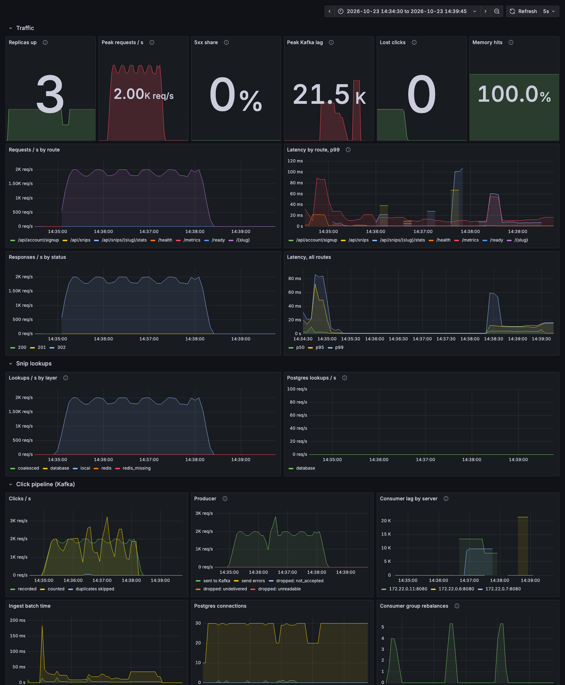

# placeholder: design

placeholder turns a paste into a short link: a URL becomes a redirect, code becomes a highlighted page, text becomes a readable one. This document explains how it's built to stay fast and correct as traffic grows and as its dependencies fail, and backs each claim with a measurement or a test. The individual decisions, with the options turned down, are in [the decision records](adr/README.md).

- [Requirements](#requirements)
- [Estimates](#estimates)
- [Architecture](#architecture)
- [Read path](#read-path)
- [Write path](#write-path)
- [Click analytics](#click-analytics)
- [Failure modes](#failure-modes)
- [Benchmarks](#benchmarks)
- [Observability](#observability)
- [At 10x and 100x](#at-10x-and-100x)

## Requirements

**What it does.** Signed-in users make links from a paste and can edit them, set them to expire, and see how often each was opened and by how many people. Anyone can open a link without an account.

**What it must do well**, in priority order:

1. **Opening a link is fast and almost never fails.** It's most of the traffic, it's what other people experience, and a broken short link is broken everywhere it was shared. It must keep working when Redis, Kafka or even Postgres is having trouble, for links that were recently opened.
2. **Counts are right.** A visit is counted once: not zero times because a queue hiccupped, not twice because it retried.
3. **Writes are durable and consistent.** A link that was created exists; an edit is seen by every server within a bounded time.
4. **Pastes stay private.** Slugs can't be guessed or enumerated, and visitor tracking stores no IP addresses.

**Shape of the load.** Reads outnumber writes by orders of magnitude, and reads are heavily skewed: a few links get most of the visits.

## Estimates

Planning numbers for a busy public service, to size each part and find what breaks first. None of these are measured; they're the load the design is checked against.

| | Assumption | Works out to |
|---|---|---|
| New links | 1 million a day | 12 a second on average, ~100 at peak |
| Link opens | 100 million a day | 1,200 a second on average, ~10,000 at peak |
| Average paste | 2 KB (links are ~100 bytes, code and logs are larger) | 2 GB a day, ~730 GB a year in Postgres |
| Hot set | 1% of a year's links get 90% of opens | ~3.6 million snips, ~7 GB: fits in one Redis |
| Slug space | 57⁷ ≈ 1.95 × 10¹² | after a year, 1 insert in ~5,000 rolls a second slug |
| Click records | ~100 bytes each in Postgres, ~60 in Kafka, both kept 7 days | ~70 GB of dedup ids and ~40 GB of log at 100M clicks a day |
| Visitor sketches | ≤ 2.6 KB per link per day, mostly far less | small: most links get few visitors on any day |

Measured on one laptop ([Benchmarks](#benchmarks)), three app servers serve 19,500 redirects a second while counting each one through Kafka. Peak load in this table is about half that, so the app tier is not the first thing to give. Postgres storage and the click dedup table are; see [At 10x and 100x](#at-10x-and-100x).

## Architecture

```text
              browsers                                          link-preview crawlers
                 │                                                       │
                 ▼                                                       ▼
          ┌─────────────┐  round-robin  ┌───────────────────────────────────────────────┐
          │    nginx    │ ────────────▶ │  Ktor app × N  (stateless, identical)          │
          └─────────────┘               │                                               │
                                        │  redirects, pages, JSON API, preview cards    │
                                        │  ┌─────────────────┐   ┌───────────────────┐  │
                                        │  │ Caffeine async  │   │ Kafka producer    │  │
                                        │  │ cache           │   │ (never blocks)    │  │
                                        │  └─────────────────┘   └─────────┬─────────┘  │
                                        │  Kafka consumer (group "rollup") │      ▲     │
                                        └────┬──────────────┬──────────────┼──────┼─────┘
                                             │              │              │      │
                         cache, rate limits, │              │ snips,       ▼      │ 12 partitions,
                         pub/sub evictions   │              │ users,   ┌──────────┴───┐ keyed by slug
                                             ▼              │ rollups  │    Kafka     │
                                      ┌────────────┐        │          │  topic       │
                                      │   Redis    │        │          │  "clicks"    │
                                      │ (LRU, no   │        ▼          └──────────────┘
                                      │  disk)     │  ┌──────────┐
                                      └────────────┘  │ Postgres │ ◀── consumers write rollups,
                                                      └──────────┘     then commit offsets

          Prometheus scrapes every app server's /metrics; Grafana draws the dashboard.
```

Everything above nginx is stateless and identical, so capacity is added by adding servers ([0008](adr/0008-one-deployable.md)). State lives in three places, each configured for what it holds: Postgres is the source of truth, Redis is a cache that can be lost at any moment, and Kafka is a durable log of visits on their way to Postgres.

## Read path

Opening `/{slug}`:

1. **Server memory** (Caffeine). Most hot links are answered here with no network call.
2. If not there: **coalesce**. If another request on this server is already looking up the same slug, wait for its answer ([0006](adr/0006-request-coalescing.md)).
3. **Redis.** A hit, or a recent "doesn't exist" marker so dead links don't reach the database.
4. **Postgres**, by primary key.
5. A link redirects with `302`; code and text get the web app's page, with its title, description and preview image written into the HTML by the server, so crawlers see the right card without running any script.
6. The visit is handed to the click buffer, without waiting ([Click analytics](#click-analytics)).

Links without an owner can never change, so they're cached for a year by browsers and CDNs. Owned links can be edited, so they're revalidated by version (a `304` when unchanged), and an edit evicts them from every server through Redis pub/sub ([0002](adr/0002-three-cache-layers.md)).

Each answer's source is counted in `snip_lookups_total{layer}`, so the dashboard shows how much traffic each layer absorbs.

## Write path

Creating a link: check the session, the per-client rate limit and the size limit, detect the kind (a URL, code in a language, or text), then insert with a random 7-character slug, retrying on the rare collision ([0001](adr/0001-random-slugs.md)). Sessions are random tokens stored only as a SHA-256 hash; passwords are Argon2id.

Editing: lock the row (`SELECT … FOR UPDATE`), check the owner, bump the version, commit, then evict everywhere.

## Click analytics

Every redirect is also a write, so counting visits must not touch the request's latency or Postgres's write load ([0003](adr/0003-kafka-for-clicks.md)).

```text
 request ──send()──▶ Kafka producer ──batches, lz4──▶ topic "clicks" ──consumer group──▶ Postgres
  (never waits)       (client's own    (linger 20 ms)   12 partitions,   one consumer       one transaction per
                       thread, 32 MB                     keyed by slug    per server         batch, then commit
                       buffer)                                                                offsets
```

- **Off the request.** `send()` appends to the producer's in-memory buffer and returns; the client batches and ships on its own thread. It's set never to block (`max.block.ms=0`): if the buffer is ever full, the click is dropped and counted rather than slowing the redirect.
- **Keyed by link.** All of a link's clicks land on one partition, so exactly one consumer owns that link's rollup row. Consumers never wait on each other's row locks, which was likely part of the backlog in the Redis Stream version, where any consumer could get any link's clicks.
- **Durable while Postgres is down.** Consumers commit offsets only after a batch's transaction commits. If Postgres fails, the consumer rewinds to the start of the batch and retries with backoff; Kafka holds the clicks (for 7 days). A consumer that dies stops heartbeating, and after 10 seconds its partitions move to the others, which resume from the last committed offset.
- **Counted exactly once.** Each click gets a UUID where it happens. Ingest skips ids it has already seen, so a batch redelivered after a crash or a rebalance can't double count ([0004](adr/0004-exactly-once-counting.md)).
- **Unique visitors without a visitor list.** Each day's visitors go into a HyperLogLog sketch stored next to the count; any range of days is the union of its sketches, within about 2% ([0005](adr/0005-hyperloglog-in-postgres.md)). Visitor ids are an HMAC of IP and user agent, so no address is stored.
- **Bots don't count.** Link-preview fetchers (Slack, Discord, WhatsApp, crawlers) identify themselves and are skipped.
- **Ready before serving.** The producer can't send until it knows the topic's partitions, so a starting server waits up to 10 seconds for Kafka before it takes traffic. If Kafka is down, it starts anyway: redirects don't need Kafka.

Owners see visits in "Your links", and the full series at `GET /api/snips/{slug}/stats`.

### Why Kafka, and what changed on the way

The pipeline first ran on a Redis Stream, with a hand-written producer and consumer. The first benchmark found that the producer always waited out its batching timer, capping each server at about 4,500 clicks a second, and **185,048 clicks were dropped**. Kafka's client already does batching, retries, failover and lag metrics, tested by everyone who uses it. On the same benchmark after the switch: **0 dropped out of 895,649**, peak backlog 31,000 instead of 325,000. [0003](adr/0003-kafka-for-clicks.md) has the full account, including how much code it saved (less than expected).

## Failure modes

What happens when each dependency fails, by design and as measured. Each "measured" entry is an experiment in [`bench/chaos.sh`](../bench/chaos.sh): 2,000 redirects a second to one link, the dependency cut off (or slowed, or the server killed) for 10 seconds, then restored, and the link's visit count compared with the redirects served. Details and dashboard screenshots are in [the benchmarks document](benchmarks.md#failure-experiments).

| Failure | Redirects | Creating and editing links | Visit counts | Measured |
|---|---|---|---|---|
| Redis down | Served from each server's memory, then Postgres | Work; rate limits fail open | Unaffected | 0 errors, all 60,000 counted |
| Kafka down | Unaffected | Work | Held in each server's producer for up to 2 minutes, then sent | 0 errors, all 60,000 counted |
| Postgres down | Recently opened links keep working from memory and Redis; others fail | Fail | Wait in Kafka; consumers retry and catch up | 0 errors, all 60,000 counted |
| Postgres slow (+250 ms) | Unaffected for cached links | Slow | Batches slower, nothing lost | 0 errors, all 60,000 counted |
| An app server dies | nginx retries on another server | Work | Its unsent 20 ms of clicks are lost; its partitions move to the others in 10 s | 0 errors, 59,990 of 60,000 counted |
| Kafka down over 2 minutes | Unaffected | Work | Clicks past the buffer are dropped and counted in `clicks_dropped_total` | Not measured |
| Redis and Postgres both down | Only links in a server's memory | Fail | Wait in Kafka | Not measured |

The experiments also caught a real bug before anything shipped: with Kafka 4's default "rebootstrap" behaviour and a producer set never to block, a 10-second Kafka outage lost every click sent during it (20,593 of 60,000). One setting fixed it; [0003](adr/0003-kafka-for-clicks.md#a-trap-the-failure-experiments-caught) has the details.

## Benchmarks

Measured with [`bench/run.sh`](../bench/run.sh) on one Apple M1 Pro laptop running the whole stack and the load generator. The headline numbers; [the benchmarks document](benchmarks.md) has every scenario and the dashboard during each run.

| | |
|---|---:|
| Redirects, one link | 19,539/s, p99 47 ms |
| Redirects, 10,000 links with Zipf-skewed traffic | 12,417/s, p99 82 ms |
| Link creation | 4,358/s, p99 32 ms |
| Cold viral link: 5,000 simultaneous requests | 3 Postgres lookups |
| Clicks dropped under full load | 0 of 895,649 |

## Observability

Every server exposes Prometheus metrics at `/metrics`. Request latency is recorded as histogram buckets rather than per-server percentiles, because percentiles from different servers can't be combined and buckets can: the dashboard's p99 is the whole fleet's. The stack runs Prometheus (`:9090`), which finds every app container through Docker's DNS, and Grafana (`:3000`), which opens on this dashboard:



| Metric | What it tells you |
|---|---|
| `ktor_http_server_requests_seconds` | Rate, status and latency histogram per route. |
| `snip_lookups_total{layer}` | Where answers come from: `local`, `redis`, `redis_missing`, `database`, `coalesced`. |
| `clicks_recorded_total`, `clicks_ingested_total`, `clicks_duplicates_total` | Clicks in, clicks counted, redeliveries recognised. |
| `clicks_dropped_total{reason}` | Clicks lost: `not_accepted` (producer buffer full), `undelivered` (Kafka down over 2 minutes), `unreadable`. Should stay at zero. |
| `kafka_producer_record_send_total`, `kafka_producer_record_error_total` | From Kafka's own client metrics: sends, and send attempts that failed and were retried. |
| `kafka_consumer_fetch_manager_records_lag_max` | How far behind each consumer is. Grows during a Postgres outage, then drains. |
| `kafka_consumer_coordinator_rebalance_total` | Partition reassignments: a server joined, left, or died. |
| `hikaricp_connections_*` | Postgres pool: active, idle, and requests waiting for a connection. |

## At 10x and 100x

What gives first, and what to do about it, in the order it would happen:

1. **Click dedup ids** (10x clicks: ~700 GB a week). Store each partition's consumed offset in Postgres in the rollup transaction and seek to it on startup; a redelivery is then skipped by position, and per-click ids aren't needed at all ([0004](adr/0004-exactly-once-counting.md)).
2. **Paste storage** (10x links: ~7 TB a year). Move content over a few KB to object storage, keyed by its SHA-256, so identical pastes are stored once and Postgres holds only metadata. Postgres stays small enough to cache in memory.
3. **Postgres reads** (100x opens with a long tail). Add read replicas for lookups; the in-memory and Redis layers already absorb the hot set, so replicas mostly serve the tail. Edits stay on the primary, and the version check on owned links tolerates replica lag.
4. **Postgres writes** (100x links). Partition `snips` by hash of slug across several Postgres instances. Random slugs spread evenly, and every lookup is by slug, so no query ever needs more than one shard.
5. **The click pipeline** (100x clicks: ~100,000 a second). Kafka itself is nowhere near its limit; the consumers are capped at 12, one per partition. Add partitions (and consumers) and run three brokers with replication factor 3. If one link takes most of the traffic, its partition is the hot spot: pre-aggregate in the producer (count per link per second) before sending.
6. **Cache Redis** (100x hot set). Redis Cluster, sharded by key. The in-memory layer means most reads never reach it.
7. **Edge.** Put a CDN in front: links without an owner are already marked `immutable`, so a CDN can serve them without ever reaching the origin.

The app tier is last on the list on purpose. Adding identical servers is the one thing this design makes trivial.
